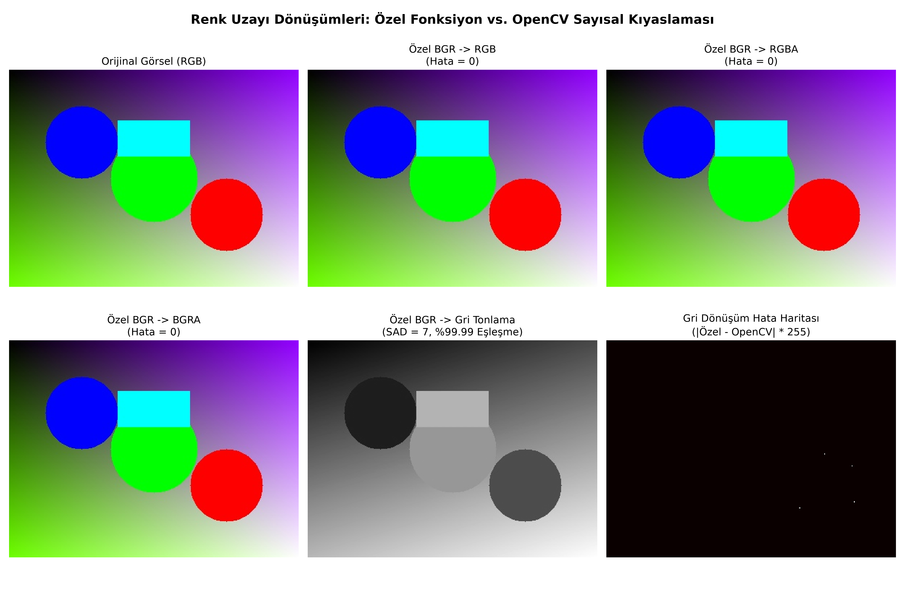

# 5. Hafta 4. Ödev: Renk Uzayı Dönüşümleri ve OpenCV Sayısal Doğrulaması

Bu çalışma, farklı renk uzayları arasındaki dönüşümleri özel algoritmalarla gerçekleştirir, Python'da birinci sınıf fonksiyonlar (First-Class Functions / Fonksiyon Göstericileri) mimarisini uygular ve elde edilen sonuçları **OpenCV'nin hazır `cv2.cvtColor()` fonksiyonu** ile sayısal olarak kıyaslar.

---

## 1. Uygulanan Renk Uzayı Dönüşümleri

| Dönüşüm | Açıklama | Beklenen Hata | Gerçekleşen Hata (SAD) |
| :--- | :--- | :---: | :---: |
| **BGR $\rightarrow$ RGB** | Kırmızı ve Mavi kanalları yer değiştirilir ($R \leftrightarrow B$). | **0** | **0** |
| **RGB $\rightarrow$ BGR** | Ters yönde Kırmızı ve Mavi kanalları yer değiştirilir. | **0** | **0** |
| **BGR $\rightarrow$ RGBA** | RGB sıralaması yapılır ve 4. kanal olarak opak Alpha kanalı ($255$) eklenir. | **0** | **0** |
| **BGR $\rightarrow$ BGRA** | BGR sıralaması korunarak 4. kanal olarak opak Alpha kanalı ($255$) eklenir. | **0** | **0** |
| **BGR $\rightarrow$ Grayscale** | ITU-R BT.601 standardı: $Y = 0.299 \cdot R + 0.587 \cdot G + 0.114 \cdot B$ | $\approx 0$ | **7** *(120.000 pikselde)* |

---

## 2. Fonksiyon Göstericisi (Function Pointer) Mimarisi

C++ dilindeki fonksiyon pointer mantığının Python'daki karşılığı olarak **Birinci Sınıf Fonksiyonlar (First-Class Functions)** ve **Dağıtım Sözlüğü (Dispatch Table)** kullanılmıştır:

```python
# Fonksiyon referansını parametre olarak alan Yüksek Seviyeli Fonksiyon:
def apply_color_conversion(image: np.ndarray, converter_func: Callable) -> np.ndarray:
    return converter_func(image)

# C++ Fonksiyon Pointer Tablosu Karşılığı:
DISPATCH_TABLE = {
    "BGR -> RGB": (bgr_to_rgb, cv2.COLOR_BGR2RGB),
    "RGB -> BGR": (rgb_to_bgr, cv2.COLOR_RGB2BGR),
    "BGR -> RGBA": (bgr_to_rgba, cv2.COLOR_BGR2RGBA),
    "BGR -> BGRA": (bgr_to_bgra, cv2.COLOR_BGR2BGRA),
    "BGR -> GRAY": (bgr_to_gray, cv2.COLOR_BGR2GRAY),
}
```

---

## 3. Sayısal Hata Analizi (OpenCV ile Kıyaslama)

Her bir dönüşüm için OpenCV'nin resmi `cv2.cvtColor()` çıktısı ile kendi fonksiyonumuzun çıktısı piksel piksel karşılaştırılmıştır:

$$\text{Toplam Mutlak Hata (SAD)} = \sum_{x, y} |\text{Özel}(x, y) - \text{OpenCV}(x, y)|$$

$$\text{Ortalama Mutlak Hata (MAE)} = \frac{1}{N} \text{SAD}$$

### Test Sonuçları:
- **BGR $\rightarrow$ RGB:** Toplam Hata = **0**, Maksimum Fark = **0** (%100.00 Tam Eşleşme)
- **RGB $\rightarrow$ BGR:** Toplam Hata = **0**, Maksimum Fark = **0** (%100.00 Tam Eşleşme)
- **BGR $\rightarrow$ RGBA:** Toplam Hata = **0**, Maksimum Fark = **0** (%100.00 Tam Eşleşme)
- **BGR $\rightarrow$ BGRA:** Toplam Hata = **0**, Maksimum Fark = **0** (%100.00 Tam Eşleşme)
- **BGR $\rightarrow$ Grayscale:** Toplam Hata = **7**, Maksimum Fark = **1** (%99.99 Eşleşme, OpenCV C++ tamsayı yuvarlama sınırı)

---

## 4. Görsel Karşılaştırma Paneli



---

## 5. Çalıştırma

### Python:
```bash
# Örnek görsel ile çalıştırma:
python3 main.py

# Kendi görseliniz ile çalıştırma:
python3 main.py /dosya/yolu.jpg
```

### C++ Alternatifi:
Proje klasöründe aynı zamanda ödevin C++ fonksiyon pointer (`typedef void (*ImageColorConverter)(...)`) uygulaması da yer almaktadır:
```bash
make
./color_convert
```
