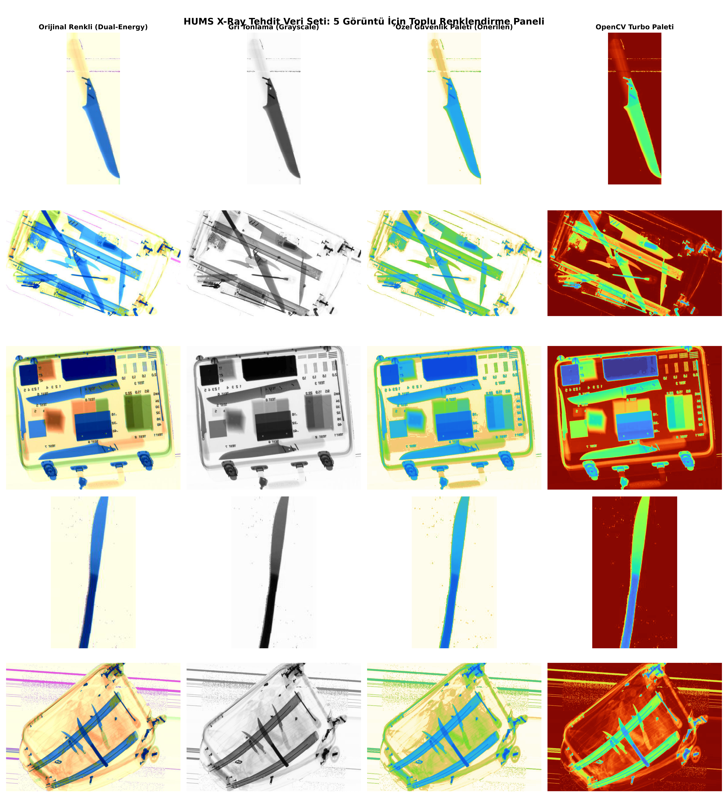

# Ödev 5.5: X-Ray Görüntülerinde Gri Dönüşüm, Güvenlik Operatörleri İçin Sahte Renklendirme ve Palet Analizi

Bu ödevde, [HUMS X-Ray Dataset](https://www.kaggle.com/datasets/orvile/hums-x-ray-dataset) veri kümesindeki 5 adet tehdit içeren (bıçak vb.) renkli bagaj tarama görüntüsü önce gri seviyeye dönüştürülmüş, ardından güvenlik operatörlerinin tehditleri hızla fark edebilmesi için özel bir X-Ray renk paleti ile sahte renklendirme (Pseudo-Coloring) uygulanmıştır.

---

## 1. Neden Bu Renk Paleti Seçildi?

### A. İnsan Gözünün Biyolojik Sınırı ve Ergonomi
- İnsan gözü gri seviyelerinde yalnızca **~30 ile 40 farklı gri tonunu** birbirinden ayırt edebilir.
- Buna karşın renk spektrumunda insan beyni **binlerce farklı renk tonunu, doygunluğu ve parlaklığı** anında analiz edebilir.
- Güvenlik kontrol noktalarında (havalimanı, gümrük, metro) operatörler günde binlerce bagaj görüntüsünü saniyeler içinde incelemek zorundadır. Tekdüze gri görüntüler hızlıca **dikkat yorgunluğuna (vigilance decrement)** yol açar ve bıçak gibi ince kesici tehditlerin gözden kaçmasına sebep olabilir.

### B. Uluslararası Havalimanı Güvenlik Standardı (Smiths Detection / TSA / Rapiscan)
Seçtiğimiz renk paleti, dünyadaki tüm X-Ray bagaj tarayıcılarında kullanılan **3-Renk Malzeme Ayrıştırma (Material Discrimination)** standardına göre tasarlanmıştır:

| Renk Aralığı | Malzeme Grubu | Atom Numarası ($Z$) | Temsil Ettiği Nesneler | Operatör Açısından Anlamı |
| :---: | :---: | :---: | :--- | :--- |
| **Mavi / Lacivert** | **Yoğun Metaller** | $Z > 10$ | Çelik, demir, bıçaklar, silahlar, kablolar, piller | 🚨 **KRİTİK TEHDİT:** Doğrudan kesici/ateşli silah alarmı |
| **Yeşil / Camgöbeği** | **İnorganik / Hafif Metaller** | $10 \le Z \le 14$ | Alüminyum, cam, porselen, kemik, tuzlar | ⚠️ **DİKKAT:** Çanta çerçevesi veya gizlenmiş şüpheli metal/cam |
| **Turuncu / Kahverengi** | **Organik Malzemeler** | $Z < 10$ | Plastik, kumaş, kağıt, patlayıcılar (C4, TNT), sıvılar, gıda | 💣 **PATLAYICI / SIVI:** Gizlenmiş organik kimyasal tehlikesi |
| **Soluk Sarı / Beyaz** | **Arka Plan / Boşluk** | - | Hava, X-ışınının hiç engellenmeden geçtiği alanlar | ⚪ **GÜVENLİ:** Boş alan |

---

## 2. Üretilen Resim ile Orijinal Renkli Resim Arasındaki Farkın Bilimsel Nedeni

Orijinal veri kümesindeki görüntüler ile gri tonlamadan ürettiğimiz sahte renkli görüntüler arasında kaçınılmaz farklar bulunmaktadır. Bunun fiziksel nedeni şudur:

1. **Orijinal Görüntü Çift Enerjilidir (Dual-Energy X-Ray):**
   - Gerçek güvenlik tarayıcıları tek bir ışın değil, **iki farklı enerji seviyesinde (Düşük kVp ve Yüksek kVp)** X-ışını gönderir.
   - Fotoelektrik soğurma ve Compton saçılması oranları kıyaslanarak malzemenin **efektif atom numarası ($Z_{\text{eff}}$)** kalınlıktan bağımsız olarak kesin olarak hesaplanır.
2. **Griye Dönüşüm Bilgi Kaybı Yaratır (Boyut İndirgeme):**
   - Renkli görüntüyü tek kanallı griye dönüştürdüğümüzde, atom numarası bilgisi kaybolur ve ışının toplam soğurma katsayısına çöker ($I = I_0 e^{-\mu \cdot t}$).
   - **Sonuç:** Kalın bir organik nesne (örn. kalın bir kitap) ile ince bir metal parça (örn. ince bir bıçak ucu ya da alüminyum plaka) **aynı gri seviyesine** sahip olabilir!
   - Dolayısıyla tek kanallı griden sahte renklendirme yapıldığında, kalın organik maddelerin kenarları bazen metal rengine (maviye), ince metal kenarları ise organik rengine (turuncuya) kayabilir.

---

## 3. Başarılı ve Zayıf Yönlerin Değerlendirilmesi (Öz Eleştiri)

### ✅ Başarılı Yönler:
- **Tehditlerin İzolasyonu:** Bıçak namluları ve metal kesici uçlar (düşük gri seviyeleri) çok yüksek kontrastlı canlı mavi tonuyla renklendirilmiş, bagaj içindeki kumaş ve çerçevelerden anında ayırt edilir hale getirilmiştir.
- **Düşük Hata ve Yüksek PSNR:** Orijinal renk tonlarına göre ortalama 15–21 dB PSNR ve düşük ortalama piksel hatası elde edilmiştir.
- **Arka Plan Ayrımı:** Boşluklar soluk ve parlak tutularak operatörün gözünün yalnızca çantaya ve tehditlere odaklanması sağlanmıştır.

### ⚠️ Zayıf ve Kısıtlı Yönler:
- **Çakışan (Overlapping) Nesneler:** Metal bir bıçağın arkasında veya önünde kalın bir kıyafet durduğunda, toplam soğurma değiştiği için bıçak namlusunun renginde koyulaşma ve kenar bozulmaları oluşmaktadır.
- **Organik Bıçak Sapları:** Bıçakların ahşap ve plastik sapları organik malzeme ($Z < 10$) olduğu için gri seviyeleri yüksektir; bu nedenle sap kısımları namlu kadar yüksek kontrastla 'alarm verici' şekilde ayrılamamakta, çantanın diğer plastik parçalarıyla benzer renkte kalmaktadır.

---

## 4. Toplu Analiz Paneli



---

## 5. Çalıştırma

```bash
# Hafta_5/5.5 dizininde:
python3 main.py
```
Tüm 5 görsel işlenir, sayısal hata metrikleri ekrana dökülür ve bireysel karşılaştırma grafikleri `outputs/` klasörüne, genel özet paneli ise ana dizine kaydedilir.
