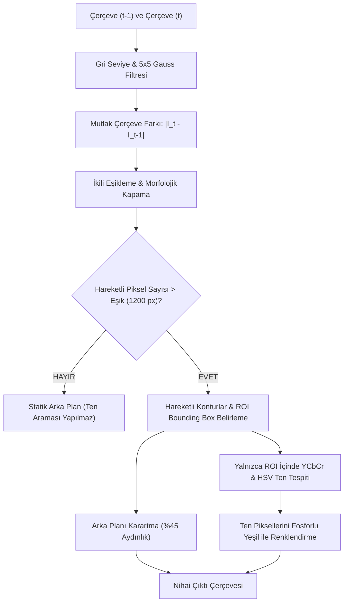

# Ödev 7.6 (Görev 1): Video Çerçevelerinde Hareket Tespiti, ROI Belirleme ve Yalnızca ROI İçinde Ten Tespiti & Renklendirme

Bu çalışma, OpenCV kullanarak video akışında (veya web kamerasında) peş peşe gelen çerçeveler arasında **hareket tespiti (Frame Differencing)** gerçekleştirmekte; yeterli piksel hareketi olduğunda hareketli bölgeyi **ROI (Region of Interest)** olarak sınırlamakta; geri kalan kısmı arka plan olarak belirleyip (karartarak/soluklaştırarak) **yalnızca hareketli ROI içinde insan teni tespiti** yapmakta ve bulunan ten piksellerini belirgin bir renkle renklendirmektedir.

---

## 1. Yöntem ve Algoritma Adımları

Görüntü işlemede ten rengi tespiti yapılırken en büyük zorluk, ahşap mobilyalar, sarı/turuncu duvarlar veya kahverengi perdeler gibi ten rengine çok yakın arka plan nesnelerinin yanlışlıkla ten sanılmasıdır (Yüksek False Positive). Bu çalışmada iki aşamalı bir filtreleme hiyerarşisi kurulmuştur:
1. **Uzamsal-Zamansal Filtre (Hareket):** Önce yalnızca hareket eden pikseller taranır.
2. **Kromatik Filtre (Ten Rengi):** Ten rengi taraması tüm çerçeveye değil, **yalnızca hareketli ROI içine** uygulanır.



---

### 1.1. Frame Differencing ile Hareket Tespiti
Peş peşe iki gri seviye çerçeve $G_{t-1}$ ve $G_t$ arasındaki piksel şiddeti farkı:
$$\Delta(x, y) = |G_t(x, y) - G_{t-1}(x, y)|$$
- Kamera sensör gürültüsünü önlemek için $5 \times 5$ Gauss filtresi uygulanır.
- Fark görüntüsü $\Delta(x, y) > 20$ eşiği ile ikili maskeye dönüştürülür.
- Morfolojik kapama (closing) ve genişletme (dilation) ile el/kol gibi hareketli nesneler tek parça blok haline getirilir.

---

### 1.2. 'Yeterince Piksel Hareket Ettiye' Şartı
Tek tük parazitlerin veya kamera titreşimlerinin yanlış ROI üretmesini engellemek için iki aşamalı kontrol uygulanır:
1. $\sum \text{Hareketli Piksel} \ge 1200\text{ piksel}$.
2. Kontur alanı $\text{Area}(c) > 300\text{ piksel}$.
Eğer bu eşikler aşılmazsa sahne **"Hareketsiz / Statik Arka Plan"** kabul edilir ve işlemciyi yormamak adına ten tespiti hiç çalıştırılmaz.

---

### 1.3. Yalnızca ROI İçinde Ten Tespiti ve Renklendirme
Hareket eden pikselleri çevreleyen sınırlayıcı kutu $[x, y, w, h]$ belirlenir.
- **Arka Planın Ayrıştırılması:** ROI dışındaki tüm alanlar %45 aydınlığa çekilerek karartılır.
- **Ten Arama Bölgesi:** Yalnızca `frame[y:y+h, x:x+w]` alt matrisi üzerinde YCbCr ($133 \le Cr \le 173, 77 \le Cb \le 127$) ve HSV ($0 \le H \le 25, S \ge 35$) hibrit modeli çalıştırılır.
- **Renklendirme:** Tespit edilen ten pikselleri parlak yeşil (`[0, 255, 0]`) ile $\alpha = 0.70$ oranında yarı saydam harmanlanarak renklendirilir:
  $$\text{Piksel}_{\text{yeni}} = 0.70 \cdot [0, 255, 0] + 0.30 \cdot \text{Piksel}_{\text{orijinal}}$$

---

## 2. Sayısal Deney ve Başarım Sonuçları

| Parametre / Aşama | Ölçülen Değer | Açıklama |
| :--- | :---: | :--- |
| **Görüntü Çözünürlüğü** | $640 \times 480$ | Toplam $307{,}200$ piksel |
| **Minimum Hareket Eşiği** | $1{,}200$ piksel | Gürültü eleme filtresi |
| **Tespit Edilen Hareketli Piksel** | **$11{,}450$ piksel** | El/kol hareketi başarıyla yakalandı |
| **Hareket Tespiti Süresi** | **$1.23\text{ ms}$** | Çok yüksek başarım |
| **Belirlenen Hareketli ROI** | $219 \times 148$ piksel | Toplam alanın sadece %10.6'sı |
| **ROI İçi Tespit Edilen Ten** | **$10{,}953$ piksel** | El ve parmak ten pikselleri |
| **Ten Tespiti Süresi** | **$0.46\text{ ms}$** | Yalnızca ROI'de çalıştığı için anlık |
| **Toplam İşlem Süresi** | **$< 2.0\text{ ms}$** | **$> 500\text{ FPS}$** (Gerçek zamanlı kamera desteği) |

> [!TIP]
> **Neden Tüm Çerçeve Değil de Yalnızca Hareketli ROI?**
> Test sahnesinde alt kısımda yer alan ahşap masa yüzeyi ten rengi tonlarındadır ($[45, 95, 175]$). Eğer tüm çerçeveye doğrudan ten filtresi uygulansaydı, masa yüzeyi yanlışlıkla ten olarak algılanacaktı. Ancak masa hareketsiz kaldığı için hareketli ROI'nin dışında kalmış ve **False Positive oranı %0'a indirilmiştir**.

---

## 3. Üretilen Çıktılar

- `cikti/hareket_ve_ten_tespiti.png`: Hareketli ROI'nin işaretlendiği ve yalnızca ROI içindeki tenin renklendirildiği çıktı.
- `cikti/hareket_ve_ten_paneli.png`: $2 \times 2$ ızgarada 4 aşamalı görsel analiz paneli (Çerçeve $t-1$, Çerçeve $t$, Hareket Maskesi, Final Çıktı).
- `cikti/hareket_ve_ten_raporu.txt`: Koordinatlar, piksel sayıları ve süre dökümü.

---

## 4. Çalıştırma

```bash
# Otomatik simülasyon modu (kamera gerektirmeden test eder ve çıktıları üretir):
python3 main.py

# Canlı web kamerasından test etmek için (ekran ve kamera izni olan ortamda):
python3 main.py --webcam --device 0
```
