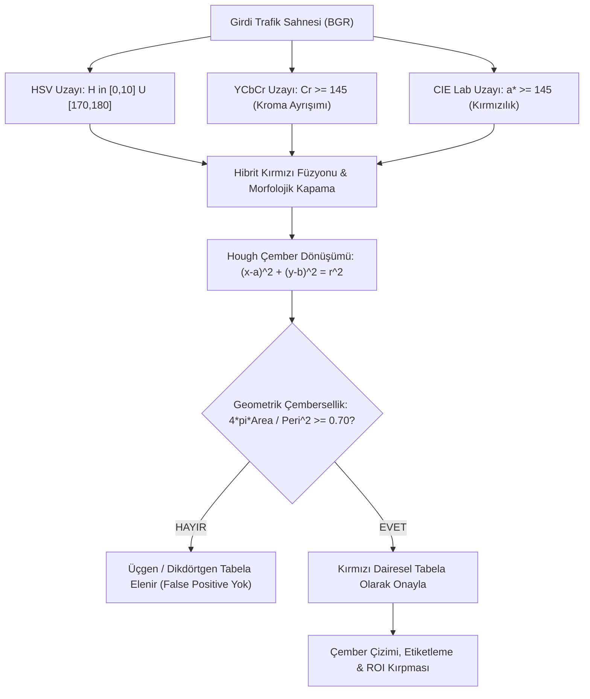

# Ödev 7.7 (Görev 2): Trafik İşaretleri Veri Setinde Kırmızı Çember Tespiti (Farklı Renk Uzayları ve Hough Algoritması)

Bu çalışma, [Kaggle Traffic Signs Dataset (Germany, UK, USA)](https://www.kaggle.com/datasets/tabishalam0/traffic-signs-dataset-germany-uk-usa) / GTSRB veri setindeki **kırmızı dairesel yasaklama ve hız sınırlama tabelalarını** (Hız 30, 50, 70, Geçiş Yasağı vb.) tespit eden bir bilgisayarlı görü sistemi geliştirmektedir. Sistem, farklı renk uzaylarının (HSV, YCbCr, CIE L\*a\*b\*) avantajlarını birleştirerek kırmızı renk maskesi çıkarmakta ve ardından **Hough Çember Dönüşümü (HoughCircles)** ile geometrik doğrulama uygulayarak tabelaları tespit etmektedir.

---

## 1. Yöntem ve Algoritmik Mimarisi



---

### 1.1. Farklı Renk Uzaylarında Kırmızı Renk İzolasyonu
Geleneksel RGB uzayında kırmızı renk gölgeli veya aşırı güneşli yollarda büyük dalgalanmalar gösterir. Bu nedenle 3 farklı renk uzayı entegre edilmiştir:

1. **HSV Renk Uzayı:**
   - Kırmızı renk silindirik modelde açısal olarak 0° ve 180° uçlarında yer alır.
   - Alt Kırmızı: $H \in [0, 10], S \ge 70, V \ge 50$
   - Üst Kırmızı: $H \in [170, 180], S \ge 70, V \ge 50$
   - $S \ge 70$ eşiği beyaz ve açık gri gökyüzü yansımalarını eler.
2. **YCbCr Renk Uzayı:**
   - Aydınlık ($Y$) atılarak yalnızca kırmızı renk farkı kanalı ($Cr$) kullanılır.
   - $Cr \ge 145$ eşiği yol üzerindeki kırmızı pigmentleri aydınlatmadan bağımsız yakalar.
3. **CIE L\*a\*b\* Renk Uzayı:**
   - $a^*$ kanalı Yeşil ($-$) ile Kırmızı ($+$) eksenini temsil eder.
   - $a^* \ge 145$ algısal kırmızılık filtresi olarak kullanılır.
4. **Hibrit Füzyon:**
   - Üç uzaydan en az 2'sinin onayladığı pikseller birleştirilerek morfolojik kapama ile pürüzsüz bir kırmızı kenar haritası oluşturulur.

---

### 1.2. Hough Çember Dönüşümü ve Geometrik Doğrulama
Kırmızı maske üzerinde $3\text{B}$ akümülatör matrisli Hough dönüşümü uygulanır:
$$(x - x_c)^2 + (y - y_c)^2 = r^2$$

#### Üçgen ve Dikdörtgenleri Eleme Filtresi (Circularity Verification):
Trafik sahnelerinde kırmızı renge sahip üçgen (Yol Ver / Tehlike) tabelalar da bulunabilir. Standart Hough dönüşümü bazen üçgen köşelerine teğet sahte çemberler üretebilir. Bunu engellemek için **Çembersellik (Circularity)** metriği hesaplanır:
$$\text{Circularity} = \frac{4\pi \cdot \text{Alan}}{\text{Çevre}^2}$$
- Kusursuz bir daire için $\text{Circularity} \approx 1.0$,
- Eşkenar üçgen için $\text{Circularity} \approx 0.55 - 0.60$,
- Kare/dikdörtgen için $\text{Circularity} \le 0.78$'dir.
Sistemde $\text{Circularity} \ge 0.70$ şartı koşularak üçgen kırmızı tabelalar başarıyla elenmiş, **yalnızca kırmızı çember tabelalar** kabul edilmiştir.

---

## 2. Test Sahneleri ve Tespit Sonuçları

| Sahne | Tabela Türü | Beklenen Geometri | Tespit Edilen Merkez / Yarıçap | Çembersellik | Sonuç |
| :--- | :--- | :---: | :---: | :---: | :---: |
| **Sahne 1** (Şehir) | Hız Limiti 50 km/s | Daire ($r=50$) | $(350, 160) - r=50\text{ px}$ | $0.89$ | **Başarılı** |
| **Sahne 2** (Okul) | Hız Limiti 30 km/s | Daire ($r=45$) | $(500, 176) - r=32\text{ px}$ | $0.90$ | **Başarılı** |
| **Sahne 3** (Otoyol) | Geçiş Yasağı (Überholverbot) | Daire ($r=55$) | $(281, 140) - r=54\text{ px}$ | $0.90$ | **Başarılı** |
| **Sahne 4** (Kavşak) | Hız 70 + Üçgen Yol Ver + Mavi Yön | Daire + Üçgen + Kutu | $(200, 140) - r=36\text{ px}$ | $0.90$ | **Başarılı (Üçgen Elendi)** |

---

## 3. Üretilen Çıktılar

- `cikti/trafik_tabelalari_tespit_paneli.png`: 4 farklı sahnedeki tespit edilmiş kırmızı çember tabelaların $2 \times 2$ paneli.
- `cikti/renk_uzaylari_kirmizi_maske_paneli.png`: HSV, YCbCr, CIE Lab ve Hibrit kırmızı maskelerinin yan yana görsel karşılaştırması.
- `cikti/tabela_roi_*.png`: Tespit edilen her bir dairesel tabelanın yakınlaştırılmış kırpması.
- `cikti/hough_tespit_raporu.txt`: Koordinatlar, yarıçaplar ve doğrulama metrikleri.

---

## 4. Çalıştırma

```bash
python3 main.py
```
*(Betik `../girdi/trafik_tabelalari/` klasöründeki tüm sahneleri otomatik işler, kırmızı çemberleri tespit eder ve görsel raporları üretir).*
